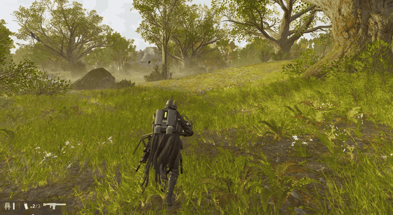
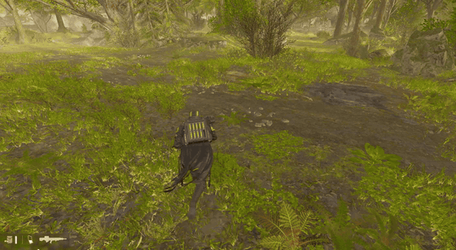
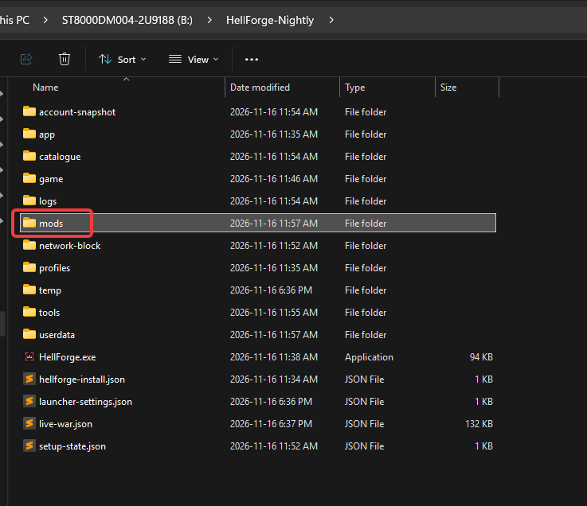
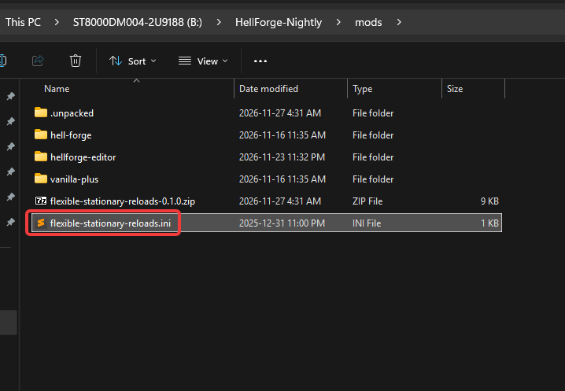

# Flexible Stationary Reloads

<small>_Disclaimer: Research help from Claude Code (finding where the game blocks the reload); the mod itself is written by me._</small>

A mod for [HellForge](https://github.com/SkyeShade/HellForge) allowing you to perform stationary reloads in more situations: while airborne with a jump pack, while falling (not ragdolled), and while diving. It used to be in the game until Arrowhead removed it as a _"bug fix"_.

**Requires HellForge 0.4.0-beta or later. Built and tested on HellForge 0.5.0-beta, for game build 25480438.**

## Preview

<p>
  
</p>

<p>
  
</p>

## Installation

1. Download the latest release from the [Releases](https://github.com/hariyomari/flexible-stationary-reloads/releases/latest) page.
2. Open the HellForge launcher, go to the Mods page and press Add mods...
3. Pick the zip. You don't need to unpack it.
4. Make sure the mod is switched on, then start the game.

You can also drop the zip directly into your HellForge `mods` folder. That is the `mods` folder inside the folder HellForge is installed in, `%USERPROFILE%\Documents\HellForge\mods` by default.

## Usage

By default, you can press reload in the air or during a dive, the same as on the ground.

The situations that are allowed can be configured in the settings (see [Settings](#settings)).

## Settings

The settings are in `flexible-stationary-reloads.ini` in your HellForge `mods` folder, which is `%USERPROFILE%\Documents\HellForge\mods` with the default install location.

HellForge's sandbox (on by default) doesn't let mods create files, so you make the settings file yourself from the template that comes with the mod. Close the game first.

1. Open the folder HellForge is installed in, then its `mods` folder.

   

2. Open the mod's zip, which is also in this `mods` folder. Its name depends on where you downloaded it. Copy `flexible-stationary-reloads.template.ini` from there into the `mods` folder. Rename the copy to `flexible-stationary-reloads.ini`, and it should now sit beside the mod's zip.

   

3. Open `flexible-stationary-reloads.ini` with a text editor, change a value and save. Changes apply the next time the game starts.

With the sandbox off, the mod creates `flexible-stationary-reloads.ini` with the defaults the first time the game starts with the mod switched on, and you can skip step 2.

| Setting           | Default | Description                                                                                                |
| ----------------- | ------- | ---------------------------------------------------------------------------------------------------------- |
| `allow_air`       | `on`    | Allows stationary reloads while airborne with a jump pack.                                                 |
| `allow_dive`      | `on`    | Allows stationary reloads while diving.                                                                    |
| `verbose_logging` | `off`   | Writes every reload step and character state change to the mod's log. Only useful for reporting a problem. |

Falling (off a ledge, for example) is allowed while either setting is on. With both off, the mod changes nothing, and reloads work as in the game without it.

## Troubleshooting

### The settings file isn't there

HellForge's sandbox (on by default) stops the mod from making it, so you copy it from the template yourself. The steps are under [Settings](#settings).

### The game is stuck at "build mods"

The first time the game starts with a mod that is built from source, HellForge downloads its compiler. This can take a few minutes, and only happens once.

## Building

HellForge builds the mod from its source when the game starts, so you don't need to build anything to play. To make the release zip yourself, run `scripts\package.bat` (or `scripts/package.sh`) with your HellForge folder:

```powershell
.\scripts\package.bat $env:USERPROFILE\Documents\HellForge        # default HellForge install location
```

The zip is written to `dist`.

## License

[MIT](LICENSE)
